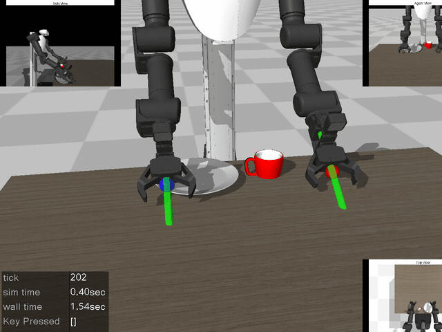
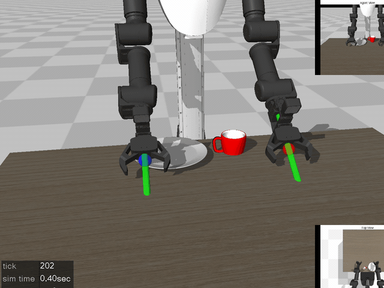
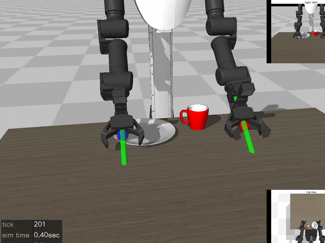

# LeRobot Tutorial with MuJoCo (ROBOTIS FFW)
This repository contains minimal examples for collecting demonstration data and training (or fine-tuning) vision language action models on custom datasets. 

This fork runs every experiment on the bimanual **ROBOTIS FFW SG2** robot instead of the original OMY manipulator. The task is the same pick-and-place: pick a mug and place it on the plate.

## Table of Contents
- [:pencil: Installation](#installation)
- [:mega: Updates and Plans](#updates--plans)
- [:video_game: 1. Collect Demonstration Data](#1-collect-demonstration-data)
- [:movie_camera: 2. Playback Your Data](#2-playback-your-data)
- [:fire: 3. Train Action-Chunking-Transformer (ACT)](#3-train-action-chunking-transformer-act)
- [:pushpin: 4. Deploy ACT](#4-deploy-your-policy)
- [:floppy_disk: 5-6. Language conditioned Environment.](#5-6-collect-data-and-visualize-in-lanugage-conditioned-environment)
- [🤗 Models and Dataset](#models-and-dataset-)
- [:zap:7.Train and deploy pi_0](#7-train-and-deploy-pi_0)
- [:bulb:8.Train and deploy smolvla](#8-train-and-deploy-smolvla)
- [:robot: State-based policy scripts](#state-based-policy-scripts)
- [:brain: 9. Zero-shot LLM control (inspect-robots)](#9-zero-shot-llm-control-inspect-robots)
- [:pencil: Acknowledgements](#acknowledgements)

## Installation
We have tested our environment on python 3.10. 

I do **not** recommend installing lerobot package with `pip install lerobot`. This causes errors. 

Install mujoco package dependencies and lerobot
```
pip install -r requirements.txt
```
Make sure your mujoco version is **3.1.6**.

Everything here was verified in a conda env created from this file:
```
conda create -n lerobot_mujoco python=3.10
conda activate lerobot_mujoco
pip install -r requirements.txt
```

Unzip the asset
```
cd asset/objaverse
unzip plate_11.zip
```

### Updates & Plans

:white_check_mark: Viewer Update.

:white_check_mark: Add different mugs, plates for different language instructions.

:white_check_mark: Add pi_0 training and inference. 

:white_check_mark: Add SmolVLA

:white_check_mark: Switch the robot to the ROBOTIS FFW SG2 (ACT trained and deployed; pi_0 / SmolVLA on FFW pending).

## 1. Collect Demonstration Data

Run [1.collect_data.ipynb](1.collect_data.ipynb)

Collect demonstration data for the bimanual FFW robot.
The task is to pick a mug and place it on the plate. The environment recognizes the success if the mug is on the plate, gthe ripper opened, and the end-effector positioned above the mug.



The GIF above replays one of the collected FFW demonstrations with the teleop overlays.

Teleoperation is bimanual, with one key set per arm:

| | Left arm | Right arm |
|---|---|---|
| Position x / y / z | W/S, A/D, R/F | I/K, J/L, U/O |
| Rotation yaw / pitch / roll | Q/E, UP/DOWN, LEFT/RIGHT | , and . , HOME/END, PAGEUP/PAGEDOWN |
| Gripper toggle | SPACE | ENTER |

Z key will reset your environment, discarding the current episode data.

For overlayed images, 
- Top Right: Agent View 
- Bottom Right: Top View
- Top Left: Side View

The FFW dataset is contained as follows:
```
fps = 20,
features={
    "observation.images.agentview": {
        "dtype": "image",
        "shape": (256, 256, 3),
        "names": ["height", "width", "channels"],
    },
    "observation.images.topview": {
        "dtype": "image",
        "shape": (256, 256, 3),
        "names": ["height", "width", "channels"],
    },
    "observation.images.sideview": {
        "dtype": "image",
        "shape": (256, 256, 3),
        "names": ["height", "width", "channels"],
    },
    "observation.state": {
        "dtype": "float32",
        "shape": (16,),
        "names": ["state"], # 7 joints of the left arm, 7 of the right arm, then left/right gripper state (0 open, 1 closed)
    },
    "action": {
        "dtype": "float32",
        "shape": (16,),
        "names": ["action"], # same layout as the state: 14 target joint angles + 2 gripper commands
    },
    "obj_init": {
        "dtype": "float32",
        "shape": (6,),
        "names": ["obj_init"], # initial mug and plate positions. Not used in training.
    },
},

```

This will make the dataset on './ffw_one_arm_data' folder, which will look like this,
```
.
├── data
│   ├── chunk-000
│   │   ├── episode_000000.parquet
│   │   └── ...
├── meta
│   ├── episodes.jsonl
│   ├── info.json
│   ├── stats.json
│   └── tasks.jsonl
└── 
```

For convenience, the 5 FFW episodes used for the ACT experiments are included in [ffw_one_arm_data](./ffw_one_arm_data/). The original OMY example data is still in [demo_data_example](./demo_data_example/).

## 2. Playback Your Data

Run [2.visualize_data.ipynb](2.visualize_data.ipynb)

</img>

Visualize your action based on the reconstructed simulation scene. The GIF above replays an FFW episode from `ffw_one_arm_data`.

The main simulation is replaying the action.

The overlayed images on the top right (agent view) and bottom right (top view) are from the dataset. 

## 3. Train Action-Chunking-Transformer (ACT)

Run [3.train.ipynb](3.train.ipynb)

**This takes around 30~60 mins**.

Train the ACT model on your custom dataset. In this example, we set chunk_size as 10. The FFW policy uses the agentview camera and the 16-dim joint state as inputs.

The trained checkpoint will be saved in './ckpt/act_y' folder. The checkpoint committed there was trained on the 5 FFW episodes in `ffw_one_arm_data`.

To evaluate the policy on the dataset, you can calculate the error between ground-truth actions from the dataset.

<image src="./media/inference.png"  width="480" height="360">

<details>
    <summary>PicklingError: Can't pickle <function <lambda> at 0x131d1bd00>: attribute lookup <lambda> on __main__ failed</summary>
If you have a pickling error, 
        
```
PicklingError: Can't pickle <function <lambda> at 0x131d1bd00>: attribute lookup <lambda> on __main__ failed
```

Please set your num_workers as 0, like, 

```
dataloader = torch.utils.data.DataLoader(
    dataset,
    num_workers=0, # 4
    batch_size=64,
    shuffle=True,
    pin_memory=device.type != "cpu",
    drop_last=True,
)
```
</details>

## 4. Deploy your Policy

Run [4.deploy.ipynb](4.deploy.ipynb)

</img>

Deploy trained policy in simulation. The GIF above is a rollout of the included FFW checkpoint in `./ckpt/act_y`, which reaches the success check after about 8 seconds of sim time.


## 5-6. Collect data and visualize in lanugage conditioned environment

- [5.language_env.ipynb](5.language_env.ipynb): Collect Dataset with keyboard teleoperation. The command is same as first environment.
- [6.visualize_data.ipynb](6.visualize_data.ipynb): Visualize Collected Data


### Environment
**Data**

</img>


## Models and Dataset 🤗
The models and dataset below are the original OMY ones, kept for reference. FFW versions of the pi_0 and SmolVLA models have not been trained yet.

<table>
  <tr>
    <th> Model 🤗 </th>
    <th> Dataset  🤗</th>
    </tr>
    <tr>
        <td> <a href="https://huggingface.co/Jeongeun/omy_pnp_pi0"> pi_0 finetuned </a></td>
        <td> <a href="https://huggingface.co/datasets/Jeongeun/omy_pnp_language"> dataset </a></td>
    </tr>
    <tr>
        <td> <a href="https://huggingface.co/Jeongeun/omy_pnp_smolvla"> smolvla finetuned </td>
        <td>  same dataset</td>
    </tr>
</table>

## 7. Train and Deploy pi_0
- [train_model.py](train_model.py): Training script
- [pi0_ffw.yaml](pi0_ffw.yaml): Training configuration file
- [7.pi0.ipynb](7.pi0.ipynb): Policy deployment


### Training Scripts
```
python train_model.py --config_path pi0_ffw.yaml
```

**Note:** the rollout and train logs below are from the original OMY runs. FFW results are pending: collect `ffw_language_data` with [5.language_env.ipynb](5.language_env.ipynb), then run the training script above.


### Rollout of trained policy

</img>


### Train logs

<image src="./media/wandb.png"  width="480" height="360">

### Configuration File
```
dataset:
  repo_id: ffw_language # Repository ID
  root: ./ffw_language_data # Your root for data file!
policy:
  type : pi0
  chunk_size: 5
  n_action_steps: 5
  
save_checkpoint: true
output_dir: ./ckpt/pi0_ffw # Save directory
batch_size: 16
job_name : pi0_ffw
resume: false 
seed : 42
num_workers: 8
steps: 20_000
eval_freq: -1 # No evaluation
log_freq: 50
save_checkpoint: true
save_freq: 10_000
use_policy_training_preset: true
  
wandb:
  enable: true
  project: pi0_ffw
  entity: <your_wandb_entity>
  disable_artifact: true
```

## 8. Train and Deploy Smolvla

- [train_model.py](train_model.py): Training script
- [smolvla_ffw.yaml](smolvla_ffw.yaml): Training configuration file
- [8.smolvla.ipynb](8.smolvla.ipynb): Policy deployment


### Training Scripts
```
python train_model.py --config_path smolvla_ffw.yaml
```

**Note:** the rollout and train logs below are from the original OMY runs. FFW results are pending: collect `ffw_language_data` with [5.language_env.ipynb](5.language_env.ipynb), then run the training script above.


### Rollout of trained policy

</img>


### Train logs

<image src="./media/wandb2.png"  width="480" height="360">

### Configuration File
```
dataset:
  repo_id: ffw_language # Repository ID
  root: ./ffw_language_data # Your root for data file!
policy:
  type : smolvla
  chunk_size: 5
  n_action_steps: 5
  device: cuda
  
save_checkpoint: true
output_dir: ./ckpt/smolvla_ffw # Save directory
batch_size: 16
job_name : smolvla_ffw
resume: false 
seed : 42
num_workers: 8
steps: 20_000
eval_freq: -1 # No evaluation
log_freq: 50
save_checkpoint: true
save_freq: 10_000
use_policy_training_preset: true
  
wandb:
  enable: true
  project: smolvla_ffw
  entity: <your_wandb_entity>
  disable_artifact: true
```


## State-based policy scripts
Standalone scripts for a proprioception-only (state-based) Diffusion Policy on the FFW, kept in [state_policy_scripts](./state_policy_scripts/):
- `rollout_wave_policy.py`: roll out a state-only policy on the FFW wave scene in MuJoCo and record videos.
- `make_rollout_montage.py`: tile the rollout videos of one policy into a single montage.
- `plot_rollouts.py`: overlay rollout joint trajectories on the demonstration trajectories.

## 9. Zero-shot LLM control (inspect-robots)

Run [9.llm_agent.ipynb](9.llm_agent.ipynb) in the `lerobot_mujoco` env.

Can a frontier LLM drive the FFW through API tool calls and finish a pick-and-place zero-shot? The harness is [inspect-robots](https://github.com/robocurve/inspect-robots), vendored as the `inspect-robots/` submodule (`git submodule update --init`). Our side lives in [ffw_inspect](./ffw_inspect/):

- `ffw_mujoco` embodiment: the tutorial scene with a 5 cm red cube instead of the mug ([asset/example_scene_llm.xml](asset/example_scene_llm.xml)), headless EGL rendering, the real robot's table-top start pose, 14-D end-effector displacement actions with IK and gravity compensation inside.
- `ffw-cube-on-plate` task: seeded layouts with a privileged success check.
- `ffw_oracle` policy: a scripted sanity check that completes the task through the same interface.

Setup, once:
```
pip install -e inspect-robots -e inspect-robots/plugins/inspect-robots-agent -e ffw_inspect
cp .env.example .env   # then put your API key in .env
```

Run from the CLI (or from the notebook):
```
inspect-robots run --task ffw-cube-on-plate --policy agent --embodiment ffw_mujoco \
    -P model=openai/gpt-6.1-sol -P wire=responses -P effort=medium --store-frames
inspect-robots view logs/      # HTML report with transcript and frames
inspect-robots video logs/<log>.json   # per-camera MP4s
```

First result (2026-10-12, one episode, seed 0, images plus proprioception only, no object positions): GPT 6.1 Sol succeeded zero-shot in 35 tool calls and 325 control steps (about 16 s of sim time). It centred over the cube using the top view, closed, checked the gripper reading, did a test lift, carried the cube to the plate, released and withdrew. Logs, frames, actions and raw API traffic are written under `logs/` (gitignored).

Real robot: the same tool surface drives the physical FFW SG2 through a `llm_agent` policy backend in the `cyclo_intelligence` repo (`cyclo_brain/policy/llm_agent`, with the `ffw_sg2_rev1_eef` robot config and the `eef_goal_bridge.py` script that feeds cyclo_control's Cartesian `vr` controller). See that backend's README for the session order and the mock-hardware dry run.

## Acknowledgements
- The assets for the ROBOTIS FFW SG2 and the original robotis-omy manipulator are from [robotis_mujoco_menagerie](https://github.com/ROBOTIS-GIT/robotis_mujoco_menagerie/tree/main) (Apache 2.0).
- The [MuJoco Parser Class](./mujoco_env/mujoco_parser.py) is modified from [yet-another-mujoco-tutorial](https://github.com/sjchoi86/yet-another-mujoco-tutorial-v3). 
- We refer to original tutorials from [lerobot examples](https://github.com/huggingface/lerobot/tree/main/examples).  
- The assets for plate and mug is from [Objaverse](https://objaverse.allenai.org/).
